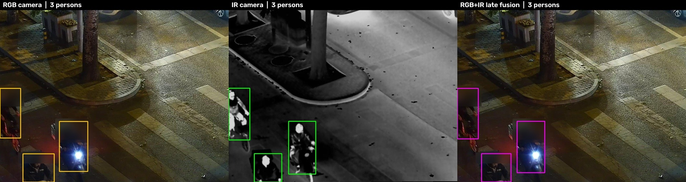
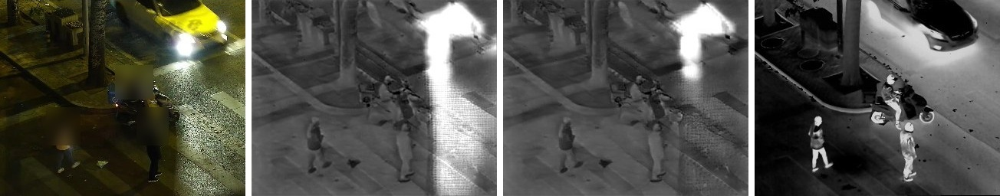
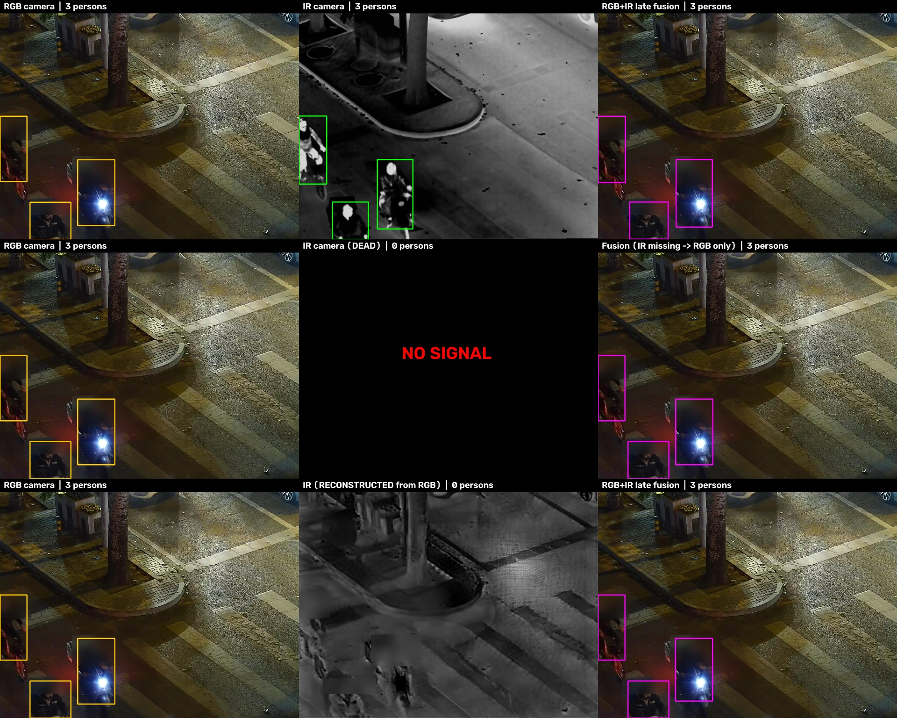
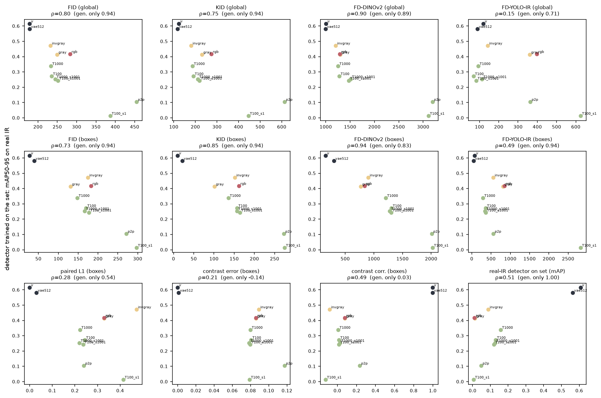
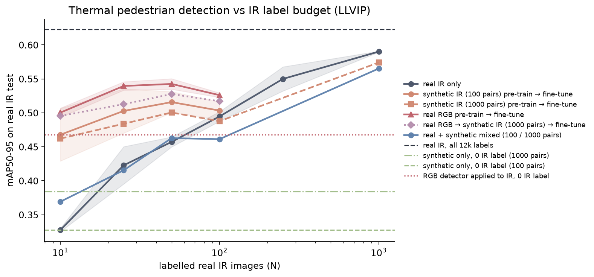
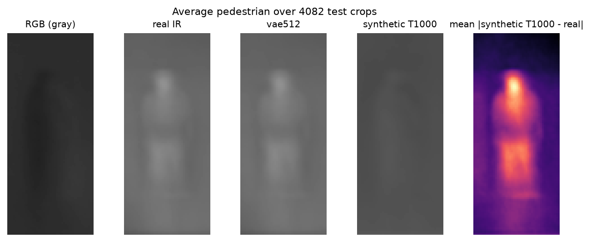
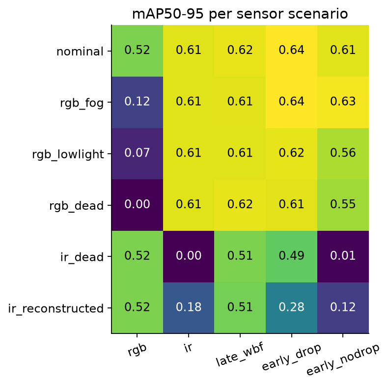

# Multimodal RGB–Thermal Pedestrian Detection with Few Labelled Data

*Seeing at night without night data.*

A personal research project on **label-efficient multimodal detection**. It compares two ways of getting infrared (IR) training labels for free, synthetic image generation and cross-modal pseudo-labelling. It also builds an RGB + IR detector that survives a degraded or dead sensor, deployed at 2.3 ms per frame on GPU.

Public data only ([LLVIP](https://bupt-ai-cz.github.io/LLVIP/)), rented GPUs (RunPod A100 / H100), every number reproducible from the scripts in this repository.

| | |
|---|---|
| **Dataset** | LLVIP (Jia et al., ICCV Workshops 2021): 15,488 pixel-aligned visible / thermal pairs, night street scenes. 12,025 train / 3,463 test, the test scenes are never seen in training |
| **Detector** | Ultralytics YOLO11s, single class `person` |
| **Metric** | mAP50-95 on the 3,463 **real IR test** images, 2 seeds per configuration, same evaluator everywhere |
| **Reference** | YOLO11s trained on all 12,025 hand-labelled real IR images: **0.623** |

Slides: [`slides/BSA_night_IR_EN_short.pptx`](slides/BSA_night_IR_EN_short.pptx) (10 slides, the structure of this README), [`slides/BSA_night_IR_EN.pptx`](slides/BSA_night_IR_EN.pptx) (31 slides). French versions: `slides/BSA_nuit_IR_FR_court.pptx`, `slides/BSA_nuit_IR_FR_v3.pptx`.

---

## Contents
1. [Objective](#1-objective)
2. [Two labelling methods](#2-two-labelling-methods)
3. [Scenarios: fusion and sensor failures](#3-scenarios-fusion-and-sensor-failures)
4. [Results](#4-results)
   - 4.1 [Synthetic image quality](#41-synthetic-image-quality)
   - 4.2 [Detection](#42-detection)
   - 4.3 [Why the generator fails](#43-why-the-generator-fails)
   - 4.4 [Robustness](#44-robustness)
   - 4.5 [Deployment](#45-deployment)
5. [Lessons learned](#5-lessons-learned)
6. [Reproducing](#6-reproducing)
7. [Repository structure](#7-repository-structure)
8. [Limitations](#8-limitations)
9. [Data, licence and privacy](#9-data-licence-and-privacy)

---

## 1. Objective

At night an RGB camera is almost blind, while a thermal camera still sees people. But **annotated thermal images are rare and expensive**, whereas **unlabelled RGB / IR pairs are cheap** (two co-mounted cameras). Two budgets:

| Budget | Amount |
|---|---|
| Hand-labelled IR images | the reference has 12,025; the realistic budget is **0 to 100** |
| Unlabelled, pixel-aligned RGB / IR pairs | **1,000** |

Two questions:
1. **With 0 to 100 IR labels and free pairs, how close can we get to 0.623?**
2. **If a camera fails, does detection survive?**


*RGB · IR · late fusion on the same frame (heads blurred).*

---

## 2. Two labelling methods

Both methods turn the free pairs into IR training data without any hand-made IR label.

### A. Translate RGB into IR (synthetic data)
- Generator: **pix2pix-turbo** ([img2img-turbo](https://github.com/GaParmar/img2img-turbo), Parmar et al. 2024). It is a one-step diffusion model (**SD-Turbo**): VAE encoder → U-Net → VAE decoder, fine-tuned with **LoRA** adapters and skip connections, trained with L2 + LPIPS + an adversarial loss.
- Trained on **100 pairs (T100)** or **1,000 pairs (T1000)** at 512×512 (`scripts/02_train_translator.sh`).
- Every RGB train image is translated into **synthetic IR**, which keeps the **true RGB boxes** (the pairs are aligned), giving 12,025 synthetic IR training images.
- Why not classic pix2pix? Trained from scratch on 100 pairs it memorises the scenes: L1 error is 0.06 on training scenes against **0.55** on new ones. The pretrained diffusion prior is what generalises (`scripts/02b_train_pix2pix.py`, `scripts/09_compare_generators.py`).


*RGB input · synthetic T100 · synthetic T1000 · real IR. Pedestrians come out **grey, not hot**: the generator copies RGB brightness, not temperature.*

### B. Pseudo-label the real IR (no generator)
- A generic **COCO-pretrained YOLO11s** (it has never seen LLVIP) runs on the RGB half and on the IR half of each pair (imgsz 1280, confidence 0.25, fixed a priori).
- The union of its person boxes (NMS 0.5) becomes the label of the **real IR image**.
- This works because RGB and IR are pixel-aligned, so a box copies as is (`scripts/14_pseudo_labels.py`).

Pseudo-label quality on the 1,000 pairs, measured against the dataset boxes:

| Source of the pseudo-labels | Precision | Recall |
|---|---|---|
| COCO detector on RGB | 0.87 | 0.34 |
| COCO detector on IR | 0.83 | 0.42 |
| **RGB + IR fused** | 0.83 | **0.50** |

At night the RGB detector misses 2 pedestrians out of 3. Running it on both modalities raises the recall from 0.34 to 0.50, so **multimodality helps to label, not only to detect**.

---

## 3. Scenarios: fusion and sensor failures

### Fusion architectures
| | Late fusion | Early fusion |
|---|---|---|
| How | two independent detectors (RGB, IR), boxes merged by **Weighted Boxes Fusion** | RGB and IR stacked into one **4-channel image**, a single YOLO11s |
| Strength | modular: if a camera dies, the other detector carries on | more accurate |
| Risk | — | the network can become dependent on IR |

**Modality dropout** applies to early fusion and to training only. 70 % of training images keep RGB + IR, 15 % have IR set to zero and 15 % have RGB set to zero. The network learns to detect with each sensor alone and to read "channel at zero = sensor missing". **Ablation:** the same model trained without dropout.

### Sensor scenarios
Each scenario is applied to the 3,463 real RGB + IR test pairs (`scripts/sensors.py`, `scripts/06_make_fusion_data.py`):

| Family | Scenarios | Question |
|---|---|---|
| Normal | nominal | baseline |
| Degraded sensor | **RGB fog** (light veil + noise), **RGB pitch dark** (gamma 2.5, gain 0.35, sensor noise) | the signal exists but is poor: does the other sensor compensate? |
| Dead sensor | **RGB dead**, **IR dead** (fully black image) | was the system designed to lose a sensor? |
| Bonus | **IR reconstructed** from RGB by the generator | can the missing sensor be hallucinated? |


*Nominal · IR dead (declared missing, fusion falls back on RGB) · IR reconstructed by the generator (0 detections). Heads blurred.*

---

## 4. Results

### 4.1 Synthetic image quality

**The control that changed everything.** Real IR train against real IR test gives FID **224**, almost as much as RGB against IR (272). The test scenes are other streets, so FID was measuring the scenery, not the modality. The fix is to measure everything **within the same scenes**: the test set is split into two halves. Reference = real IR half A, compared set = its half-B version in each modality. The control (real IR B ↔ A) then drops to FID **11.6**, the yardstick for every other number (`scripts/04_gap_metrics.py`).

**On the whole image, metrics rank data sources wrongly.** "Usefulness" below means: a detector trained only on that type of data, tested on real IR.

| Set B ↔ real IR test A | FID | KID×1000 | FD-DINOv2 | Density / coverage | Usefulness |
|---|---|---|---|---|---|
| real IR (control) | 11.6 | 0.09 | 31 | 1.01 / 0.98 | 0.623 |
| synthetic IR T100 | 234.7 | 173 | 1,209 | 0 / 0 | 0.328 |
| synthetic IR T1000 | 229.4 | 163 | 1,198 | 0 / 0 | 0.384 |
| real RGB | 271.7 | **228** | 1,262 | 0 / 0 | **0.468** |

Every metric says RGB is the farthest from real IR, yet RGB trains the best IR detector. Whole-image metrics judge overall appearance, dominated by the background (pedestrians are ~3 % of the pixels). In DINOv2 space, synthetic IR even forms its **own cluster**, neither RGB nor IR (`results/figures/umap.png`).

**Which metric does predict usefulness?** I tested 12 metrics on **11 image sets** whose usefulness spans 0.01 to 0.61. The sets are real IR, IR passed through the VAE, grey, inverted grey, RGB, five pix2pix-turbo checkpoints and classic pix2pix. Usefulness = YOLO11s trained on 3,000 images of the set (30 epochs), tested on real IR; this proxy ranks sets in the same order as full trainings. Metrics are computed on the whole image or **on the pedestrian crops only**, with Inception, DINOv2 or the IR detector's own features (FD-YOLO-IR) (`scripts/11_make_proxy_sets.py`, `12_box_metrics.py`, `15_metric_correlation.py`).

| Metric (set B ↔ real IR test A) | Spearman ρ with usefulness (11 sets) | Generators only (6 sets) |
|---|---|---|
| **FD-DINOv2, pedestrian crops** | **0.94** (p < 0.001, Pearson 0.98, leave-one-out 0.92–0.95) | 0.83 |
| FD-DINOv2, whole image | 0.90 | 0.89 |
| KID, crops | 0.85 | 0.94 |
| FID, whole image | 0.80 | 0.94 |
| KID, whole image | 0.75 | 0.94 |
| FID, crops | 0.73 | 0.94 |
| Detectability (real-IR detector applied to the set) | 0.51 | **1.00** |
| FD-YOLO-IR, crops | 0.49 | 0.94 |
| Pedestrian / background contrast (correlation · error) | 0.49 · 0.21 | 0.03 · −0.14 |
| Paired L1, crops | 0.28 | 0.54 |
| FD-YOLO-IR, whole image | 0.15 | 0.71 |

With 11 points ρ ≥ 0.62 is significant at 5 %; with 12 metrics the Bonferroni threshold is p < 0.004, which only FD-DINOv2 on crops passes.

- **On pedestrian crops, the DINOv2 distance tracks usefulness**, and it is the only metric that ranks RGB ahead of synthetic IR.
- **The IR detector's own features fail across sources.** They measure resemblance to IR: RGB looks alien to them (detectability 0.01), yet it trains well.
- **Between generators**, almost every metric ranks correctly.



### 4.2 Detection

**Zero hand-labelled IR image.** Every detector is a YOLO11s tested on the 3,463 real IR test images.

| Training set | mAP50-95 |
|---|---|
| Method A: 12,025 **generated (fake) IR** T1000, true RGB boxes | 0.384 |
| 12,025 generated IR T100, true RGB boxes | 0.328 |
| 100 **real IR**, pseudo-labels from RGB + IR | 0.358 |
| 1,000 **real IR**, pseudo-labels from RGB only | 0.424 |
| 12,025 **real RGB**, true boxes (no IR at all) | 0.468 |
| **Method B: 1,000 real IR, pseudo-labels from RGB + IR** | **0.529** (0.523 on a second machine) |
| *Reference: best with 100 hand-labelled real IR images* | *0.526* |

**Method B, with zero IR labels, beats every method that uses 100 hand-labelled IR images.**

**With N hand-labelled real IR images.** Each detector is pre-trained (or not), then fine-tuned for 100 epochs on N real IR images. Mean of 2 seeds, tested on real IR test.

| N | real IR only | generated IR T100 → real | **real RGB → real** | RGB → generated IR → real | RGB + IR pseudo-labels → real |
|---|---|---|---|---|---|
| 10 | 0.328 | 0.468 | **0.500** | 0.496 | 0.475 |
| 25 | 0.423 | 0.503 | **0.540** | 0.513 | 0.489 |
| 50 | 0.458 | 0.516 | **0.543** | 0.528 | 0.496 |
| 100 | 0.495 | 0.504 | 0.526 | 0.517 | 0.517 |

- Synthetic pre-training helps (+0.14 at N = 10), but **real RGB with the same boxes helps more at every N**. The gain came from the RGB *labels* the generator carries, not from the translation. Adding the synthetic step on top of RGB brings nothing.
- **Fine-tuning the pseudo-label detector lowers it** (0.529 → 0.475 with 10 images): 100 epochs on a few images make it forget what 1,000 pseudo-labelled images taught it. The fine-tuning recipe, designed for a weak starting point, must be gentler.



### 4.3 Why the generator fails

**Is it the architecture?** The **VAE ceiling test** checks this. Real IR test images are pushed through the generator's own compression steps, without the translation: resize to 512², then SD-Turbo VAE encode → decode. The real-IR detector is then applied to the result (`scripts/13_ceiling_pedestrians.py`).

| Real IR test passed through… | mAP50-95 | Pedestrian recall |
|---|---|---|
| nothing | 0.618 | 0.930 |
| resize 512² | 0.628 | 0.932 |
| VAE at full resolution | 0.618 | 0.928 |
| **512² + VAE (like the generator)** | **0.620** | 0.923 |

The architecture loses nothing. The test is even pessimistic, because it ignores pix2pix-turbo's skip connections.

**Pedestrian by pedestrian (8,302 test pedestrians, IoU ≥ 0.5, conf ≥ 0.25):**
- recall of the real-IR detector: real IR 0.93, VAE 0.92, **generated IR T1000 0.22**;
- **76 %** of the pedestrians found on real IR are lost on T1000;
- **89 %** of those lost are found by the RGB detector on the RGB image, so they were visible in the generator's input;
- only **2 %** are also lost after the VAE alone, so neither size nor compression explains it;
- the lost ones are the **darker pedestrians in RGB** (luminance 0.12 vs 0.18), although they are just as warm in real IR. T1000's recall rises from 0.08 to 0.35 with RGB brightness, while it stays flat on real IR. A logistic regression gives AUC 0.72, with RGB luminance as the first factor.

**The generator follows light, not heat.** It has to invent a temperature that is almost absent from its input.


*Average of 4,082 test pedestrian crops (anonymous by construction): dark in RGB, warm head and torso in real IR, uniform in synthetic T1000; the error map peaks on head and torso.*

### 4.4 Robustness

mAP50-95 on the 3,463 real RGB + IR test pairs, all scored with the same evaluator (`scripts/det_eval.py`, validated against Ultralytics: 0.491 vs 0.488).

| Scenario | RGB only | IR only | Late fusion | **Early + dropout** | Early, no dropout |
|---|---|---|---|---|---|
| Nominal | 0.516 | 0.610 | 0.620 | **0.642** | 0.610 |
| RGB fog | 0.124 | 0.610 | 0.613 | **0.641** | 0.633 |
| RGB pitch dark | 0.068 | 0.610 | 0.610 | **0.617** | 0.563 |
| RGB dead | 0.000 | 0.610 | 0.619 | **0.614** | 0.550 |
| IR dead | 0.516 | 0.000 | 0.514 | **0.485** | 0.007 |
| IR reconstructed from RGB | 0.516 | 0.177 | 0.507 | 0.276 | 0.118 |

- **Degraded RGB** (fog, dark): IR and fusion hold (0.61–0.64).
- **IR dead:** early fusion collapses to **0.007 without dropout** and keeps **0.485 with it**. Without dropout the network leans on IR, and a black image is an input it has never seen.
- **IR reconstructed** by the generator: 0.276, **worse than declaring IR missing** (0.485). It looks like IR but carries false content, and the model trusts it.



### 4.5 Deployment

IR detector, TensorRT FP16, batch 1, A100, measured in the same run (`scripts/08_export_trt.py`, `scripts/16_gpu_pipeline.py`):

| Pipeline | End-to-end latency | p95 | mAP50-95 |
|---|---|---|---|
| Ultralytics + TensorRT (pre/post-processing on CPU) | 4.04 ms | 4.86 ms | 0.613 |
| **100 % GPU** (CUDA pre-processing, NMS inside the engine, pinned memory) | **2.30 ms (435 img/s)** | **2.46 ms** | 0.612 |

TensorRT divides inference by 4, but the total only by 1.7: CPU pre- and post-processing took 60 % of the time (Amdahl's law). One bug was instructive. A pinned-memory copy through `torch` cost **98 ms**, because coordinating 128 OpenMP threads costs a hundred times more than copying 4 MB; `np.copyto` brought it down to 0.45 ms.

A Gradio demo (`app/demo.py`) shows the three cases: nominal, IR declared dead, and IR reconstructed by the generator.

---

## 5. Lessons learned

| | Lesson | Evidence |
|---|---|---|
| **L1** | **Compare to the strongest naive baseline.** | My first conclusion ("synthetic IR helps: +0.14") was overturned by a baseline I had forgotten: real RGB with the same boxes beats synthetic IR at every N. |
| **L2** | **Transfer labels rather than translate images.** | Pseudo-labelled real IR (RGB + IR fused): 0.529 with zero IR labels. Missing labels cost less than a wrong appearance. |
| **L3** | **The generator lacks information, not capacity.** | VAE ceiling 0.620 vs 0.618; 76 % of pedestrians lost on T1000, 89 % of them visible in RGB: it follows light, not heat. |
| **L4** | **Measure images where the detector looks.** | Whole-image metrics mislead between data sources; on pedestrian crops, FD-DINOv2 tracks usefulness (ρ = 0.94 over 11 sets). The task's own features measure resemblance, not information. |
| **L5** | **A dead sensor is declared, not hallucinated.** | Modality dropout: IR dead 0.007 → 0.485; reconstructed IR 0.276. And end-to-end latency is won outside the network (4.04 → 2.30 ms). |

> **A synthetic image is only useful if it brings information the available data does not already have. Here, the missing piece was heat.**

**Next steps:**
- a generator guided by physics or supervised on pedestrians, adopted only if it beats the pseudo-label baseline;
- iterative self-training and a gentler fine-tuning recipe;
- INT8.

---

## 6. Reproducing

**Environment.** Linux, one ≥ 40 GB GPU (runs were done on an A100 80 GB, partly replicated on an H100). `scripts/setup_pod.sh` creates the venv and pins the key versions: `ultralytics==8.3.253`, `diffusers==0.32.2`, `tensorrt-cu12<11`, PyTorch with CUDA 12. It also downloads LLVIP (official release). Clone [img2img-turbo](https://github.com/GaParmar/img2img-turbo) into `/workspace/bsa/img2img-turbo` for the generator. Scripts assume the project lives in `/workspace/bsa` (code in `/workspace/bsa/code`), as on the pod.

**Pipeline.** Each script's docstring lists its inputs and outputs.

| Step | Script | What it does |
|---|---|---|
| S1 | `01_make_splits.py`, `make_small_splits.py` | LLVIP → YOLO format, paired 512² data for the generator, nested N = 10…1000 splits (seeded) |
| S2 | `02_train_translator.sh` (+ `02b_train_pix2pix.py`) | train pix2pix-turbo on 100 / 1,000 pairs (classic pix2pix baseline) |
| S3 | `03_generate_ir.py` | translate RGB into synthetic IR |
| S4 | `04_gap_metrics.py` | FID, KID, FD-DINOv2, density / coverage, L1 / SSIM / LPIPS on the A/B test halves |
| S5 | `05_train_detector.py` | train a YOLO11s on any mix of sources, evaluate on real IR test |
| S6 | `10_figures.py` | figures and `results/tables.md` |
| S7 | `06_make_fusion_data.py`, `07_multimodal.py`, `sensors.py`, `det_eval.py` | 4-channel data, sensor scenarios, robustness matrix |
| S8 | `08_export_trt.py`, `16_gpu_pipeline.py` | TensorRT FP16 export, latency benchmarks, 100 % GPU pipeline |
| E1–E5 | `11_make_proxy_sets.py`, `12_box_metrics.py`, `13_ceiling_pedestrians.py`, `14_pseudo_labels.py`, `15_metric_correlation.py` | proxy sets, crop metrics, VAE ceiling and per-pedestrian analysis, pseudo-labelling, metric ↔ usefulness correlation |
| Demo | `app/demo.py` | Gradio app (port 7860) |

The `queue_*.sh` files are the exact job queues that produced the results (tmux on the pod).

**What is not in this repository.** The trained weights (YOLO detectors, pix2pix-turbo LoRA checkpoints, TensorRT engines), the LLVIP data and the cached features are not versioned (size, and LLVIP is redistributed only by its authors). Cloning the repository therefore does **not** give a runnable demo: the pipeline above must be run first, which is what produces `runs/det/*/weights/last.pt`, `ckpt/translator_N1000/` and `deploy/*.engine`.

**Running the demo (`app/demo.py`).** Once the weights exist:

```bash
export BSA_ROOT=/workspace/bsa        # folder holding data/, runs/, ckpt/, deploy/, code/, img2img-turbo/
python app/demo.py                     # http://localhost:7860
DEMO_DEVICE=cpu python app/demo.py     # force the CPU fallback
```

| Hardware | What works |
|---|---|
| NVIDIA GPU (≈ 8 GB VRAM is enough for inference, CUDA 12) | everything: RGB / IR detectors (TensorRT if `deploy/*.engine` exists, else PyTorch), WBF fusion, sensor scenarios, **IR reconstructed by the generator** |
| CPU only | RGB / IR detectors (PyTorch weights) and WBF fusion, fog / low-light scenarios, "IR dead → fall back to RGB". The **"reconstruct IR" mode is hidden**, because pix2pix-turbo (img2img-turbo) hard-codes CUDA; latencies are those of the CPU, not the 2.3 ms GPU figures |

A cloud GPU was needed for **training** (A100 80 GB); inference only needs a consumer NVIDIA card, or a CPU for detection and fusion.

**Slides.** `slides/build_deck*.js` generate the decks with `pptxgenjs` (`npm install` in `slides/`). They use a theme helper passed through the `PPTX_SKILL` environment variable. `slides/make_assets.py` builds the images, with heads blurred.

---

## 7. Repository structure

```
app/demo.py                 Gradio demo (nominal / IR dead / IR reconstructed)
scripts/                    full pipeline (S1–S8, E1–E6), sensor models, evaluator, job queues
results/
  det/*.json                every detector: config + mAP on real IR test
  boxmetrics/               crop vs whole-image metrics, correlation (11 sets)
  explain/                  VAE ceiling, per-pedestrian analysis (8,302 pedestrians)
  h100/                     replication run (second machine)
  figures/*.png             plots used above
  tables.md                 all results in tables
slides/                     decks (EN / FR), deck builders, blurred assets
doc/                        working notes (FR): reasoning behind each choice, architecture, bugs, issues
```

`doc/explications.md` (French) explains why each test was run, which question it answers and why it is more rigorous than the previous one. `doc/bugs.md` logs the 20 bugs met on the way, among them a lost GPU, a driver mismatch and SIGSTOP having no effect in a container.

---

## 8. Limitations

- **One dataset** (LLVIP: few scenes, a single camera rig). Conclusions about generators may not transfer to other sensors or to daytime.
- **One generator family** (pix2pix-turbo) and small budgets: 2,501–3,001 training steps, constrained by the rented GPU time.
- **Proxy usefulness** for the correlation study (3,000 images, 30 epochs). It ranks sets like the full trainings on the three sets checked, and 11 points remain few.
- **In `12_box_metrics.py`, the A/B test halves are contiguous, not shuffled**, so A and B are different scenes, unlike in `04_gap_metrics.py`. The comparison between sets stays valid (same reference for all), and this is what shows that crop metrics ignore the scenery (control KID 124 on the whole image vs 10 on crops). Absolute whole-image values in that file are not comparable with section 4.1.
- **2 seeds** per configuration: differences below ~0.01 mAP should not be over-read.

---

## 9. Data, licence and privacy

- **LLVIP** is released for non-commercial research use; this repository contains **no LLVIP image**, only derived figures and slide crops. Please download the dataset from its authors.
- **Privacy:** heads are blurred on every RGB image shown (slides, figures). The "average pedestrian" is an average of thousands of crops and is anonymous by construction.
- Code written from scratch for this project, except the third-party libraries it calls (Ultralytics, diffusers, img2img-turbo, TensorRT, ensemble-boxes, clean-fid, transformers).
